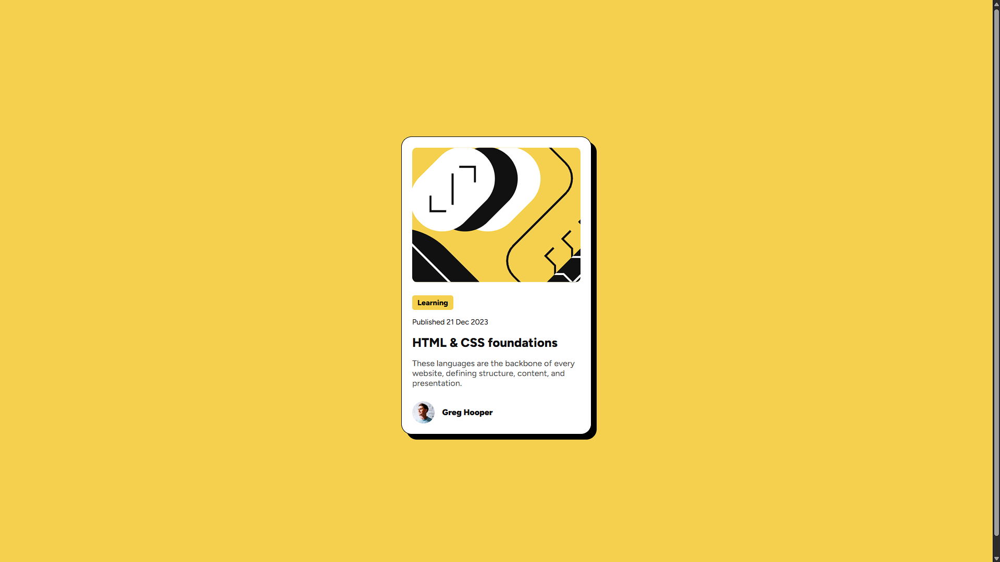

# Frontend Mentor - Blog preview card solution

This is a solution to the [Blog preview card challenge on Frontend Mentor](https://www.frontendmentor.io/challenges/blog-preview-card-ckPaj01IcS). Frontend Mentor challenges help you improve your coding skills by building realistic projects. 

## Table of contents

- [Overview](#overview)
  - [The challenge](#the-challenge)
  - [Screenshot](#screenshot)
  - [Links](#links)
- [My process](#my-process)
  - [Built with](#built-with)
- [Author](#author)

**Note: Delete this note and update the table of contents based on what sections you keep.**

## Overview

### The challenge

Users should be able to:

- See hover and focus states for all interactive elements on the page

### Screenshot

### Links

- Solution URL: [https://www.frontendmentor.io/solutions/blog-preview-card-using-css-flexbox-5UQhpcsF1m](https://www.frontendmentor.io/solutions/blog-preview-card-using-css-flexbox-5UQhpcsF1m)
- Live Site URL: [https://supakat.github.io/blog-preview-card-main/](https://supakat.github.io/blog-preview-card-main/)

## My process
- Used a Flexbox to create the center card.
- Put the correct text in paragraphs, divs, and headings.
- Added the images.
- Styled the illustration image and it's div container to match the required design
- Styled the div containing "learning".
- Adjusted the font weight, family, and size.
- Styled the profile div to get the correct positioning.
- Changed the text and background colors.
- Corrected spacing between elements.

### Built with

- Semantic HTML5 markup
- CSS custom properties
- Flexbox
- CSS Grid

## Author

- Frontend Mentor - [@SupaKat](https://www.frontendmentor.io/profile/SupaKat)
